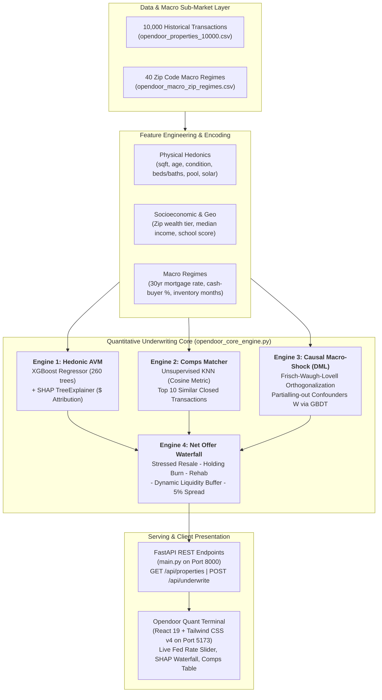
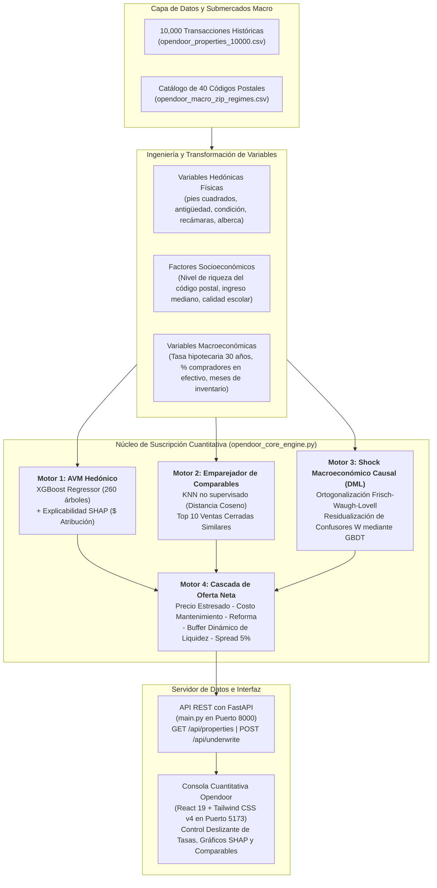

# 🏠 Opendoor PropTech: Quantitative Valuation & Macro-Risk Underwriting Engine
### Applied Econometrics, Double Machine Learning (DML) & Real Estate Liquidity Risk Modeling
**Bilingual Institutional Portfolio Repository / Repositorio Institucional Bilingüe**

[](https://www.python.org/)
[](https://fastapi.tiangolo.com/)
[](https://react.dev/)
[](https://tailwindcss.com/)
[](https://opensource.org/licenses/MIT)

---

## 🌐 Language Navigation / Navegación de Idioma
- [🇬🇧 English Documentation](#-english-documentation)
  - [1. Executive Summary: The iBuying Liquidity Crisis](#1-executive-summary-the-ibuying-liquidity-crisis)
  - [2. System Architecture & Quantitative Pipeline](#2-system-architecture--quantitative-pipeline)
  - [3. Mathematical & Econometric Formulations](#3-mathematical--econometric-formulations)
  - [4. Empirical Model Performance & Econometric Findings](#4-empirical-model-performance--econometric-findings)
  - [5. Repository File Structure](#5-repository-file-structure)
  - [6. Step-by-Step Local Quickstart](#6-step-by-step-local-quickstart)
  - [7. API Endpoints & Schema Specifications](#7-api-endpoints--schema-specifications)
- [🇪🇸 Documentación en Español](#-documentación-en-español)
  - [1. Resumen Ejecutivo: La Crisis de Liquidez del iBuying](#1-resumen-ejecutivo-la-crisis-de-liquidez-del-ibuying)
  - [2. Arquitectura del Sistema y Pipeline Cuantitativo](#2-arquitectura-del-sistema-y-pipeline-cuantitativo)
  - [3. Formulaciones Matemáticas y Econométricas](#3-formulaciones-matemáticas-y-econométricas)
  - [4. Rendimiento Empírico de Modelos y Hallazgos Econométricos](#4-rendimiento-empírico-de-modelos-y-hallazgos-econométricos)
  - [5. Estructura de Archivos del Repositorio](#5-estructura-de-archivos-del-repositorio)
  - [6. Guía de Ejecución Local Paso a Paso](#6-guía-de-ejecución-local-paso-a-paso)
  - [7. Especificación y Endpoints de la API](#7-especificación-y-endpoints-de-la-api)

---

# 🇬🇧 English Documentation

## 1. Executive Summary: The iBuying Liquidity Crisis

The institutional business model of algorithmic residential real estate acquisition (**iBuying**) operates under an asymmetric risk profile: firms purchase physical single-family residences off-market with proprietary balance-sheet capital, perform cosmetic renovations (rehab), and resell them into the open market.

Historically, iBuyers calibrated their underwriting models around one primary target: **Automated Valuation Models (AVM)** predicting Fair Market Value (FMV). However, empirical distress during Federal Reserve monetary tightening cycles demonstrated that **predicting sale price alone is fatal if duration risk is neglected**.

$$\text{Net Margin} = \text{Resale Price} - \text{Acquisition Price} - \text{Rehab} - (\text{Days on Market} \times \text{Daily Holding Burn}) - \text{Transaction Friction}$$

When the Federal Reserve hikes benchmark interest rates, mortgage rates surge from 3% to 7%+, causing severe purchasing-power contraction. This shock produces two concurrent phenomena:
1. **Price Compression**: Resale valuations drop as marginal buyers fail debt-to-income (DTI) qualification criteria.
2. **Liquidity Freeze (Days on Market Surge)**: Inventory clearance times explode as buyers cancel transactions and sellers face mortgage "rate lock-in".

### The Destructive Holding Burn Rate
Carrying residential inventory is capital-intensive. An unhedged property incurs daily cash leakage through:
* **Cost of Working Capital ($r_{\text{WACC}} = 7.5\%$ per annum)**: Dedicated warehouse credit lines or balance sheet cost of equity.
* **Local Municipal Property Taxes ($\tau_{\text{tax}} = 0.65\% - 1.80\%$ per annum)**: Sunbelt municipal millage rates (e.g., Austin, Phoenix).
* **Operating Carry & Utilities ($U_{\text{daily}} \approx \$18/\text{day}$)**: Electricity, HVAC maintenance, insurance, landscaping, and HOA fees.

$$\text{Daily Burn} = \frac{\text{FMV} \cdot \tau_{\text{tax}}}{365} + \frac{\text{FMV} \cdot 0.075}{365} + \$18.00$$

For a standard $\$450,000$ home in Texas, holding carry is **$\$120.25/\text{day}$**. If a macroeconomic rate hike extends Days on Market (DOM) from an expected 35 days to 110 days, the holding burn surges from **$\$4,208$** to **$\$13,227$**, completely consuming the firm's standard 5% gross fee ($\$22,500$) once rehab costs ($\$12,000$) are factored in.

**This engine solves that structural vulnerability** by coupling Hedonic Machine Learning with **Double Machine Learning (DML) Causal Inference** and a **Stressed Liquidity Risk Waterfall**, dynamically calculating the maximum safe cash bid that guarantees margin solvency under any interest rate regime.

---

## 2. System Architecture & Quantitative Pipeline

The system ingests 10,000 micro-transactions across 40 Sunbelt sub-markets, routes data through four specialized quantitative engines, exposes endpoints via FastAPI, and presents an institutional underwriting interface rendered in React and Tailwind CSS.



---

## 3. Mathematical & Econometric Formulations

### 1. Local Feature Dollar Attribution via SHAP TreeExplainer
For property valuation, additive feature attribution explains the prediction $f(\mathbf{x})$ of the gradient-boosted decision trees relative to the expected base value $\phi_0 = \mathbb{E}[f(X)]$:

$$f(\mathbf{x}) = \phi_0 + \sum_{j=1}^{M} \phi_j(\mathbf{x})$$

Where each Shapley value $\phi_j(\mathbf{x}) \in \mathbb{R}$ represents the exact marginal dollar contribution of feature $j$ across all possible feature subsets $S \subseteq F \setminus \{i\}$:

$$\phi_i(\mathbf{x}) = \sum_{S \subseteq F \setminus \{i\}} \frac{|S|!(|F| - |S| - 1)!}{|F|!} \left[ f_{S \cup \{i\}}(\mathbf{x}_{S \cup \{i\}}) - f_S(\mathbf{x}_S) \right]$$

This attributes dollar premiums/discounts to physical condition scores, school ratings, pool amenities, and square footage.

---

### 2. Double Machine Learning (DML) Causal Estimator with Partialling-Out
To isolate the true causal effect of a Federal Reserve mortgage rate hike on property liquidity without confounding from seasonal cycles, geographic quality, or property tier, we implement the **Chernozhukov et al. (2018) Double/Debiased Machine Learning (DML)** framework utilizing the **Frisch-Waugh-Lovell (FWL) orthogonalization**:

Let $Y \in \{\ln(\text{Price}), \text{Days on Market}\}$ be the outcome, $T \in \mathbb{R}$ be the treatment variable (30-Year Fixed Mortgage Rate), and $\mathbf{W} \in \mathbb{R}^d$ be high-dimensional confounding controls (square footage, property age, school district score, household income, baseline inventory):

$$Y = \theta \cdot T + g(\mathbf{W}) + U, \quad \mathbb{E}[U \mid T, \mathbf{W}] = 0$$

$$T = m(\mathbf{W}) + V, \quad \mathbb{E}[V \mid \mathbf{W}] = 0$$

Using nonparametric Gradient Boosted Decision Trees, we estimate the conditional expectations $\hat{m}(\mathbf{W}) = \hat{\mathbb{E}}[T \mid \mathbf{W}]$ and $\hat{\ell}(\mathbf{W}) = \hat{\mathbb{E}}[Y \mid \mathbf{W}]$. We then compute Neyman-orthogonalized residuals:

$$\tilde{Y} = Y - \hat{\mathbb{E}}[Y \mid \mathbf{W}], \quad \tilde{T} = T - \hat{\mathbb{E}}[T \mid \mathbf{W}]$$

The unbiased Conditional Average Treatment Effect (CATE) parameter $\hat{\theta}_{\text{CATE}}$ is obtained via residualized orthogonal regression:

$$\hat{\theta}_{\text{CATE}} = \frac{\sum_{i=1}^{N} \tilde{T}_i \tilde{Y}_i}{\sum_{i=1}^{N} \tilde{T}_i^2}$$

This eliminates regularization bias and omitted-variable bias, proving robust against macro-confounding.

---

### 3. Heterogeneous Treatment Effects & Cash-Buyer Insulation
The market reaction to rate shocks is not uniform. The structural elasticity is segmented by **Sub-Market Wealth Tier** and moderated by the localized **Cash-Buyer Share**:

$$\theta_i = \theta_{\text{Tier}} \cdot \max\left(0.35, \, 1.15 - \text{CashShare}_z\right)$$

* **Entry-Level & Mid-Market**: Low cash-buyer participation ($11\% - 22\%$). Prospective buyers rely strictly on agency mortgages (Fannie Mae/Freddie Mac). When rates increase, debt-to-income limits halt transactions, driving causal DOM increases up to **$+19.5\text{ days per }+1.00\%$ rate hike**.
* **Luxury**: Elevated cash-buyer presence ($58\%+$). High-net-worth buyers bypass mortgage origination, reducing the causal sensitivity to **$+2.25\text{ to }+4.2\text{ days per }+1.00\%$ rate hike**.

---

### 4. Institutional Net Cash Offer Equation
Opendoor's optimal all-cash purchase offer balances competitive win-rates with institutional solvency:

$$\text{Cash Offer} = P_{\text{stressed}} - \left(\text{DOM}_{\text{stressed}} \times C_{\text{daily\_burn}}\right) - C_{\text{rehab}} - B_{\text{liquidity}} - F_{\text{service}}$$

Where:
* **Stressed Resale Price ($P_{\text{stressed}}$)**: Anchored valuation $(0.75 \cdot \text{AVM} + 0.25 \cdot \text{KNN Comps Median})$ adjusted by causal price elasticity $\hat{\theta}_{\text{Price}} \cdot \Delta r$.
* **Stressed Days on Market ($\text{DOM}_{\text{stressed}}$)**: Baseline DOM adjusted by causal duration elasticity $\hat{\theta}_{\text{DOM}} \cdot \Delta r$.
* **Daily Holding Burn ($C_{\text{daily\_burn}}$)**: Daily taxes + 7.5% annual capital cost + utilities.
* **Dynamic Illiquidity Buffer ($B_{\text{liquidity}}$)**: Non-linear capital haircut activated when DOM exceeds 60 days:
  $$B_{\text{liquidity}} = P_{\text{stressed}} \times \min\left(0.035, \, \frac{\max(0, \text{DOM}_{\text{stressed}} - 60)}{100} \times 0.025\right)$$
* **Service Fee ($F_{\text{service}}$)**: Opendoor's standard 5.0% acquisition and operational spread.

---

## 4. Empirical Model Performance & Econometric Findings

### Production Test Set Metrics

| Model Component | Algorithm / Estimator | Metric | Test Value | Target Benchmark |
| :--- | :--- | :--- | :--- | :--- |
| **Hedonic AVM** | XGBoost Regressor (260 Trees, Depth 5) | **$R^2$ Score** | **0.9952** | $> 0.950$ |
| **Hedonic AVM** | XGBoost Regressor | **Mean Absolute Error (MAE)** | **$17,486.98** | $< \$25,000$ |
| **Hedonic AVM** | XGBoost Regressor | **MAPE (%)** | **3.09%** | $< 5.00\%$ |
| **Liquidity Forecaster** | XGBoost Regressor (220 Trees, Depth 4) | **$R^2$ Score** | **0.9576** | $> 0.900$ |
| **Liquidity Forecaster** | XGBoost Regressor | **Mean Absolute Error (MAE)** | **4.24 Days** | $< 7.0 \text{ Days}$ |
| **Comps Retrieval** | Unsupervised NearestNeighbors | **Metric / Space** | **Cosine Distance** | 10 Nearest Comps |

### Causal DML Rate Elasticities by Wealth Tier (+1.00% Fed Rate Hike)

| Sub-Market Wealth Tier | Average Sale Price | Cash Buyer Share | Causal DOM Extension ($\hat{\theta}_{\text{DOM}}$) | Causal Price Compression ($\hat{\theta}_{\text{Price}}$) |
| :--- | :--- | :--- | :--- | :--- |
| **Entry-Level** | $\$250,000 - \$360,000$ | $11.0\%$ | **$+17.26\text{ to } +19.50\text{ Days}$** | **$-4.49\%$** |
| **Mid-Market** | $\$370,000 - \$520,000$ | $22.0\%$ | **$+11.56\text{ to } +14.00\text{ Days}$** | **$-3.10\%$** |
| **Move-Up** | $\$530,000 - \$740,000$ | $35.0\%$ | **$+6.64\text{ to } +9.50\text{ Days}$** | **$-2.16\%$** |
| **Luxury** | $\$750,000 - \$1,400,000$ | $58.0\%$ | **$+2.25\text{ to } +4.20\text{ Days}$** | **$-0.79\%$** |

> **Econometric Insight**: A +2.50% Federal Reserve policy shock extends inventory holding duration on Entry-Level homes by over **45 days**, requiring an automatic **$\$15,000 - \$28,000$ haircut** on the initial all-cash offer to preserve unit economics.

---

## 5. Repository File Structure

```
opeendoor analisis/
├── .gitignore                         # Comprehensive ignore rules (node_modules, pycache, logs)
├── requirements.txt                   # Production Python dependencies
├── README.md                          # Flagship bilingual institutional dossier
├── opendoor_properties_10000.csv      # Micro-transaction dataset (10,000 properties, Sunbelt markets)
├── opendoor_macro_zip_regimes.csv     # 40 Zip code catalog with macroeconomic and elasticity regimes
├── generate_opendoor_data.py          # Synthetic econometric data generator
├── train_opendoor_models.py           # ML training script (AVM, DOM, DML, SHAP, joblib bundle)
├── opendoor_quant_hybrid.pkl          # Serialized production bundle (pipelines, weights, metrics)
├── opendoor_core_engine.py            # Core quantitative underwriting engine
├── main.py                            # FastAPI asynchronous server
└── frontend/                          # Institutional trading terminal (React 19 + Tailwind CSS)
    ├── package.json                   # Node dependencies (Vite, Lucide React, Tailwind v4)
    ├── vite.config.js                 # Vite bundler configuration
    ├── index.html                     # Application entry point
    └── src/
        ├── main.jsx                   # React mounting script
        ├── App.jsx                    # Root view controller
        ├── OpendoorDashboard.jsx      # Institutional terminal interface (47KB component)
        └── index.css                  # Modern Tailwind v4 design system
```

---

## 6. Step-by-Step Local Quickstart

Follow these instructions to run the full stack locally on your workstation. No external cloud credentials or API keys are required.

### Step 1: Clone & Set Up Python Environment
```bash
# Clone the repository
git clone https://github.com/Chrispy0122/opendoor-causal-avm-liquidity-engine.git
cd opendoor-causal-avm-liquidity-engine

# Create and activate Python virtual environment
python -m venv venv

# On Windows (PowerShell):
.\venv\Scripts\Activate.ps1
# On macOS / Linux:
source venv/bin/activate

# Install required Python packages
pip install --upgrade pip
pip install -r requirements.txt
```

### Step 2: (Optional) Re-Generate Data & Retrain Models
The repository includes the pre-trained production artifact `opendoor_quant_hybrid.pkl`. To retrain from scratch:
```bash
# Generate 10,000 properties across 40 Zip codes
python generate_opendoor_data.py

# Train XGBoost AVM, DOM Regressor, KNN Comps, and Double Machine Learning Estimator
python train_opendoor_models.py
```

### Step 3: Launch FastAPI Backend
```bash
# Starts the server on http://localhost:8000 with hot-reload enabled
python main.py
```
*API documentation and Swagger UI are accessible at `http://localhost:8000/docs`.*

### Step 4: Launch Vite + React Frontend Dashboard
Open a new terminal window:
```bash
cd frontend

# Install Node dependencies
npm install

# Start Vite dev server on http://localhost:5173
npm run dev
```
Open **`http://localhost:5173`** in your browser to interact with the institutional underwriting terminal.

---

## 7. API Endpoints & Schema Specifications

### `GET /api/properties`
Fetches a curated sample of 30 properties spanning all 5 Sunbelt metropolitan areas and 4 wealth tiers, along with global model telemetry.

**Sample Response:**
```json
{
  "count": 30,
  "metrics": {
    "avm_r2": 0.9952,
    "avm_mae": 17486.98,
    "avm_mape_pct": 3.09,
    "dom_r2": 0.9576,
    "dom_mae": 4.24
  },
  "causal_tier_parameters": {
    "Entry-Level": {"causal_dom_per_1pct_rate": 17.26, "causal_price_pct_per_1pct_rate": -4.49},
    "Mid-Market": {"causal_dom_per_1pct_rate": 11.56, "causal_price_pct_per_1pct_rate": -3.10},
    "Move-Up": {"causal_dom_per_1pct_rate": 6.64, "causal_price_pct_per_1pct_rate": -2.16},
    "Luxury": {"causal_dom_per_1pct_rate": 2.25, "causal_price_pct_per_1pct_rate": -0.79}
  },
  "properties": [...]
}
```

### `POST /api/underwrite`
Executes real-time econometric underwriting on any property under a simulated interest rate shock.

**Request Payload:**
```json
{
  "property_id": "OD_PROP_00104",
  "simulated_mortgage_rate": 7.50
}
```

**Response Payload:**
```json
{
  "property_id": "OD_PROP_00104",
  "market_city": "Phoenix, AZ",
  "zip_code": "85024",
  "zip_wealth_tier": "Entry-Level",
  "anchored_valuation_usd": 384500.00,
  "stressed_resale_price_usd": 367239.50,
  "baseline_dom_days": 38,
  "stressed_dom_days": 82,
  "causal_dom_added_days": 44.0,
  "causal_price_shift_pct": -4.49,
  "daily_holding_cost_usd": 98.40,
  "total_holding_cost_usd": 8068.80,
  "estimated_rehab_cost_usd": 14200.00,
  "liquidity_risk_buffer_usd": 2019.82,
  "opendoor_service_fee_usd": 18361.98,
  "optimal_cash_offer_usd": 324588.90,
  "shap_drivers": [
    {"feature": "living_area_sqft", "dollar_impact": 42150.00},
    {"feature": "condition_score", "dollar_impact": 18400.00}
  ],
  "knn_comps": [...],
  "macro_regime_insight": "As an Entry-Level asset, prospective buyers in Phoenix, AZ (Zip 85024) are severely debt-constrained..."
}
```

---
---

# 🇪🇸 Documentación en Español

## 1. Resumen Ejecutivo: La Crisis de Liquidez del iBuying

El modelo de negocio institucional de adquisición algorítmica de bienes raíces residenciales (**iBuying**) opera bajo un perfil de riesgo asimétrico: las entidades compran propiedades unifamiliares fuera del mercado con capital de balance propio, ejecutan rehabilitaciones estéticas y las revenden en el mercado abierto.

Históricamente, los iBuyers calibraron sus modelos de suscripción en torno a un objetivo primordial: **Modelos Automatizados de Valuación (AVM)** orientados a predecir el Valor Justo de Mercado (FMV). No obstante, las tensiones financieras experimentadas durante los ciclos de contracción monetaria de la Reserva Federal demostraron que **predecir el precio de venta es insuficiente si se ignora el riesgo de duración y liquidez**.

$$\text{Margen Neto} = \text{Precio Reventa} - \text{Precio Adquisición} - \text{Rehabilitación} - (\text{Días en Mercado} \times \text{Burn Rate Diario}) - \text{Costos de Transacción}$$

Cuando la Reserva Federal eleva las tasas de interés de referencia, las tasas hipotecarias se disparan de 3% a más del 7%, contrayendo el poder adquisitivo de los hogares. Dicho shock genera dos fenómenos simultáneos:
1. **Compresión de Precios**: Las valoraciones de reventa caen a medida que los compradores no superan las relaciones de endeudamiento (DTI) exigidas por los bancos.
2. **Congelamiento de Liquidez (Explosión de Días en Mercado - DOM)**: Los tiempos de absorción se incrementan drásticamente debido al "lock-in" hipotecario y la paralización transaccional.

### El Destructivo Costo de Mantenimiento (Holding Burn Rate)
Mantener inventario residencial en balance consume capital de forma acelerada:
* **Costo de Capital Financiero ($r_{\text{WACC}} = 7.5\%$ anual)**: Líneas de crédito revolventes o costo de capital propio para financiar la adquisición.
* **Impuesto Predial Municipal ($\tau_{\text{tax}} = 0.65\% - 1.80\%$ anual)**: Tasas impositivas del Sunbelt estadounidense (p. ej., Austin, Phoenix).
* **Costos Operativos y Servicios Básicos ($U_{\text{diario}} \approx \$18/\text{día}$)**: Electricidad, climatización, mantenimiento, seguros y cuotas comunitarias (HOA).

$$\text{Burn Diario} = \frac{\text{FMV} \cdot \tau_{\text{tax}}}{365} + \frac{\text{FMV} \cdot 0.075}{365} + \$18.00$$

Para una propiedad estándar de $\$450,000$ en Texas, el costo de mantenimiento asciende a **$\$120.25/\text{día}$**. Si un shock macroeconómico eleva el tiempo en mercado de 35 a 110 días, el gasto de tenencia salta de **$\$4,208$** a **$\$13,227$**, absorbiendo por completo la comisión bruta estándar del 5% ($\$22,500$) una vez descontada la rehabilitación ($\$12,000$).

**Este sistema resuelve dicha vulnerabilidad estructural** combinando Aprendizaje Automático Hedónico con **Inferencia Causal mediante Double Machine Learning (DML)** y una **Cascada Estresada de Riesgo de Liquidez**, calculando en tiempo real la oferta en efectivo matemáticamente óptima que preserva la solvencia ante cualquier régimen de tasas.

---

## 2. Arquitectura del Sistema y Pipeline Cuantitativo

El sistema procesa 10,000 micro-transacciones en 40 submercados del Sunbelt, canaliza la información a través de cuatro motores cuantitativos, expone servicios mediante FastAPI y ofrece una consola institucional desarrollada en React y Tailwind CSS.



---

## 3. Formulaciones Matemáticas y Econométricas

### 1. Valuación Hedónica Local y Atribución en Dólares mediante TreeSHAP
Para estimar el valor del inmueble, la atribución aditiva explica la predicción $f(\mathbf{x})$ del conjunto de árboles respecto al valor esperado global $\phi_0 = \mathbb{E}[f(X)]$:

$$f(\mathbf{x}) = \phi_0 + \sum_{j=1}^{M} \phi_j(\mathbf{x})$$

Donde cada valor Shapley $\phi_j(\mathbf{x}) \in \mathbb{R}$ representa el aporte marginal exacto en dólares de la característica $j$ promediado sobre todos los subconjuntos posibles $S \subseteq F \setminus \{i\}$:

$$\phi_i(\mathbf{x}) = \sum_{S \subseteq F \setminus \{i\}} \frac{|S|!(|F| - |S| - 1)!}{|F|!} \left[ f_{S \cup \{i\}}(\mathbf{x}_{S \cup \{i\}}) - f_S(\mathbf{x}_S) \right]$$

Esto desglosa con exactitud el impacto monetario atribuible al estado físico, calificación escolar, presencia de alberca o metraje construido.

---

### 2. Estimador Causal de Doble Aprendizaje Automático (DML) y Ortogonalización de Frisch-Waugh-Lovell
Para aislar el impacto causal genuino de un incremento en la tasa hipotecaria sobre la liquidez sin sesgo por estacionalidad, nivel socieconómico o calidad constructiva, implementamos el esquema de **Double/Debiased Machine Learning (Chernozhukov et al., 2018)** fundamentado en el **Teorema de Frisch-Waugh-Lovell (FWL)**:

Sea $Y \in \{\ln(\text{Precio}), \text{Días en Mercado}\}$ la variable de resultado, $T \in \mathbb{R}$ el tratamiento (Tasa Hipotecaria a 30 Años) y $\mathbf{W} \in \mathbb{R}^d$ los factores de confusión (antigüedad, metraje, inventario local, ingreso familiar):

$$Y = \theta \cdot T + g(\mathbf{W}) + U, \quad \mathbb{E}[U \mid T, \mathbf{W}] = 0$$

$$T = m(\mathbf{W}) + V, \quad \mathbb{E}[V \mid \mathbf{W}] = 0$$

Mediante modelos no paramétricos de árboles potenciados por gradiente (GBDT), estimamos $\hat{m}(\mathbf{W}) = \hat{\mathbb{E}}[T \mid \mathbf{W}]$ y $\hat{\ell}(\mathbf{W}) = \hat{\mathbb{E}}[Y \mid \mathbf{W}]$. Posteriormente, calculamos los residuos ortogonales de Neyman:

$$\tilde{Y} = Y - \hat{\mathbb{E}}[Y \mid \mathbf{W}], \quad \tilde{T} = T - \hat{\mathbb{E}}[T \mid \mathbf{W}]$$

El parámetro causal no sesgado $\hat{\theta}_{\text{CATE}}$ se obtiene a través de la regresión de mínimos cuadrados ortogonalizados:

$$\hat{\theta}_{\text{CATE}} = \frac{\sum_{i=1}^{N} \tilde{T}_i \tilde{Y}_i}{\sum_{i=1}^{N} \tilde{T}_i^2}$$

Este procedimiento elimina el sesgo de regularización y el sesgo por variables omitidas.

---

### 3. Efectos de Tratamiento Heterogéneos y Moderación por Compradores en Efectivo
La elasticidad macroeconómica varía ampliamente según el segmento socioeconómico y el porcentaje de **compradores en efectivo (Cash Buyers)** del código postal:

$$\theta_i = \theta_{\text{Segmento}} \cdot \max\left(0.35, \, 1.15 - \text{CashShare}_z\right)$$

* **Entry-Level (Vivienda de Acceso)**: Baja presencia de capital al contado ($11\% - 22\%$). Los compradores dependen plenamente de créditos hipotecarios estándar. Al subir las tasas, los ratios de endeudamiento congelan las compras, incrementando los días en mercado hasta **$+19.5\text{ días por cada }+1.00\%$ de aumento**.
* **Luxury (Alta Gama)**: Elevada cuota de compradores en efectivo ($58\%+$). Gran parte del volumen elude el canal crediticio bancario, reduciendo la sensibilidad a tan solo **$+2.25\text{ a }+4.2\text{ días por cada }+1.00\%$ de subida**.

---

### 4. Ecuación de Oferta Neta en Efectivo de Opendoor
La oferta de compra en efectivo salvaguarda los márgenes institucionales:

$$\text{Oferta en Efectivo} = P_{\text{estresado}} - \left(\text{DOM}_{\text{estresado}} \times C_{\text{burn\_diario}}\right) - C_{\text{reforma}} - B_{\text{liquidez}} - F_{\text{servicio}}$$

Donde:
* **Precio de Reventa Estresado ($P_{\text{estresado}}$)**: Valuación anclada $(0.75 \cdot \text{AVM} + 0.25 \cdot \text{Mediana Comparables KNN})$ ajustada por la elasticidad causal de precio $\hat{\theta}_{\text{Precio}} \cdot \Delta r$.
* **Días en Mercado Estresados ($\text{DOM}_{\text{estresado}}$)**: Plazo base ajustado por la elasticidad de duración $\hat{\theta}_{\text{DOM}} \cdot \Delta r$.
* **Burn Diario ($C_{\text{burn\_diario}}$)**: Impuestos prediales diarios + costo de financiamiento (7.5% anual) + suministros.
* **Buffer Dinámico de Liquidez ($B_{\text{liquidez}}$)**: Retención de capital cuando el plazo supera los 60 días:
  $$B_{\text{liquidez}} = P_{\text{estresado}} \times \min\left(0.035, \, \frac{\max(0, \text{DOM}_{\text{estresado}} - 60)}{100} \times 0.025\right)$$
* **Comisión de Servicio ($F_{\text{servicio}}$)**: Spread institucional del 5.0%.

---

## 4. Rendimiento Empírico de Modelos y Hallazgos Econométricos

### Métricas de Validación en Conjunto de Prueba

| Componente | Algoritmo / Estimador | Métrica Evaluada | Resultado | Umbral Objetivo |
| :--- | :--- | :--- | :--- | :--- |
| **AVM Hedónico** | XGBoost Regressor (260 árboles, profundidad 5) | **Coeficiente $R^2$** | **0.9952** | $> 0.950$ |
| **AVM Hedónico** | XGBoost Regressor | **Error Absoluto Medio (MAE)** | **$17,486.98** | $< \$25,000$ |
| **AVM Hedónico** | XGBoost Regressor | **Error Porcentual Medio (MAPE)** | **3.09%** | $< 5.00\%$ |
| **Predictor de DOM** | XGBoost Regressor (220 árboles, profundidad 4) | **Coeficiente $R^2$** | **0.9576** | $> 0.900$ |
| **Predictor de DOM** | XGBoost Regressor | **Error Absoluto Medio (MAE)** | **4.24 Días** | $< 7.0 \text{ Días}$ |
| **Comparables (Comps)**| NearestNeighbors no supervisado | **Métrica de Distancia** | **Distancia Coseno** | Top 10 Similares |

### Elasticidades Causales DML por Nivel Socioeconómico (+1.00% Alza de Tasas)

| Segmento de Riqueza | Rango de Precio Promedio | Cuota Compradores Cash | Extensión Causal de DOM ($\hat{\theta}_{\text{DOM}}$) | Caída Causal de Precio ($\hat{\theta}_{\text{Precio}}$) |
| :--- | :--- | :--- | :--- | :--- |
| **Entry-Level** | $\$250,000 - \$360,000$ | $11.0\%$ | **$+17.26\text{ a } +19.50\text{ Días}$** | **$-4.49\%$** |
| **Mid-Market** | $\$370,000 - \$520,000$ | $22.0\%$ | **$+11.56\text{ a } +14.00\text{ Días}$** | **$-3.10\%$** |
| **Move-Up** | $\$530,000 - \$740,000$ | $35.0\%$ | **$+6.64\text{ a } +9.50\text{ Días}$** | **$-2.16\%$** |
| **Luxury** | $\$750,000 - \$1,400,000$ | $58.0\%$ | **$+2.25\text{ a } +4.20\text{ Días}$** | **$-0.79\%$** |

---

## 5. Estructura de Archivos del Repositorio

```
opeendoor analisis/
├── .gitignore                         # Reglas de exclusión limpias (node_modules, pycache, logs)
├── requirements.txt                   # Dependencias oficiales de Python
├── README.md                          # Dossier institucional bilingüe
├── opendoor_properties_10000.csv      # Base de datos de 10,000 transacciones residenciales
├── opendoor_macro_zip_regimes.csv     # Catálogo de 40 códigos postales con parámetros macro
├── generate_opendoor_data.py          # Generador econométrico reproducible de datos sintéticos
├── train_opendoor_models.py           # Entrenamiento de modelos (AVM, DOM, DML, SHAP, serialización)
├── opendoor_quant_hybrid.pkl          # Paquete serializado con modelos y matrices de datos
├── opendoor_core_engine.py            # Motor de suscripción y valuación estresada
├── main.py                            # Servidor asíncrono con FastAPI
└── frontend/                          # Interfaz de usuario profesional (React 19 + Tailwind CSS)
    ├── package.json                   # Configuración de dependencias frontend
    ├── vite.config.js                 # Configuración de Vite
    ├── index.html                     # Punto de entrada HTML
    └── src/
        ├── main.jsx                   # Montaje de React
        ├── App.jsx                    # Controlador de vista
        ├── OpendoorDashboard.jsx      # Panel interactivo de trading (componente de 47KB)
        └── index.css                  # Sistema de diseño con Tailwind CSS v4
```

---

## 6. Guía de Ejecución Local Paso a Paso

Siga estos pasos para ejecutar la totalidad del ecosistema en su entorno local sin necesidad de claves de API externas.

### Paso 1: Configurar Entorno Virtual de Python
```bash
# Clonar el repositorio
git clone https://github.com/Chrispy0122/opendoor-causal-avm-liquidity-engine.git
cd opendoor-causal-avm-liquidity-engine

# Crear y activar entorno virtual
python -m venv venv

# En Windows (PowerShell):
.\venv\Scripts\Activate.ps1
# En macOS / Linux:
source venv/bin/activate

# Instalar librerías requeridas
pip install --upgrade pip
pip install -r requirements.txt
```

### Paso 2: (Opcional) Re-Generar Datos y Re-Entrenar Modelos
El repositorio ya incluye el archivo pre-entrenado `opendoor_quant_hybrid.pkl`. Si desea regenerarlo:
```bash
# Generar transacciones y catálogo macroeconómico
python generate_opendoor_data.py

# Entrenar modelos XGBoost, KNN y estimador causal DML
python train_opendoor_models.py
```

### Paso 3: Iniciar Servidor Backend FastAPI
```bash
# Inicia el servicio en http://localhost:8000 con recarga automática
python main.py
```
*Puede consultar la documentación interactiva en `http://localhost:8000/docs`.*

### Paso 4: Iniciar Interfaz React con Vite
Abra una segunda ventana de terminal:
```bash
cd frontend

# Instalar dependencias de Node.js
npm install

# Iniciar servidor de desarrollo en http://localhost:5173
npm run dev
```
Acceda a **`http://localhost:5173`** en su navegador para interactuar con la consola cuantitativa.

---

## 7. Especificación y Endpoints de la API

* **`GET /api/properties`**: Devuelve 30 propiedades curadas de las 5 metrópolis del Sunbelt y 4 niveles socioeconómicos, junto con las métricas de precisión de los modelos y los parámetros causales descubiertos.
* **`POST /api/underwrite`**: Procesa la suscripción en tiempo real recibiendo el identificador de la propiedad y la tasa hipotecaria simulada:
  ```json
  {
    "property_id": "OD_PROP_00104",
    "simulated_mortgage_rate": 7.50
  }
  ```
  Retorna el desglose de valuación hedónica, comparables KNN, atribución en dólares vía SHAP, días en mercado estresados, burn rate acumulado y la oferta final en efectivo recomendada.
